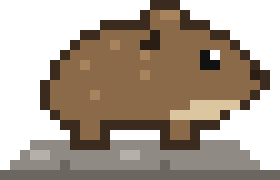

<p align="center">
  
</p>

<p align="center">
  <a href="https://github.com/khkstudios/dassie-50m/releases"></a>
  <a href="https://github.com/khkstudios/dassie-50m"></a>
  <a href="https://github.com/khkstudios/dassie-50m/commits/main"></a>
  <a href="LICENSE"></a>
  <br>
  <a href="https://www.python.org/"></a>
  <a href="https://pytorch.org/"></a>
  <a href="https://developer.apple.com/metal/pytorch/"></a>
  <a href="https://huggingface.co/khkstudios/dassie-50m"></a>
  <a href="https://github.com/huggingface/tokenizers"></a>
  <a href="https://docs.astral.sh/uv/"></a>
</p>

# dassie-50m

*Named after the dassie (rock hyrax), the small, round, rock-sunbathing mammal of South Africa.*

A ~55M parameter language model built **from scratch** in PyTorch and trained on the
[TinyStoriesV2-GPT4](https://huggingface.co/datasets/roneneldan/TinyStories) dataset, a corpus of short
children's stories written by GPT-4.

The model is a hand-written Llama-style transformer (RMSNorm, rotary embeddings, SwiGLU). Its weights export
directly to Hugging Face's `LlamaForCausalLM` format, so the finished model runs in `transformers`, llama.cpp,
Ollama and LM Studio with no custom code.

**Model on Hugging Face:** https://huggingface.co/khkstudios/dassie-50m

## Layout

```
dassie/            model.py (the transformer), config.py (presets), tokenizer.py, data.py, utils.py
scripts/           train_tokenizer.py → prepare_data.py → train.py → sample.py → export_hf.py → push_hf.py (+ render_card.py)
tests/             model sanity checks + HF export parity test
model_card.md      Hugging Face model card template ({{placeholders}} filled by push_hf.py)
```

## Setup

Requires [uv](https://docs.astral.sh/uv/). Training runs on Apple Silicon (MPS), NVIDIA (CUDA) or CPU.

```bash
uv sync --all-extras
uv run pytest
```

Download `TinyStoriesV2-GPT4-train.txt` from the
[dataset page](https://huggingface.co/datasets/roneneldan/TinyStories/tree/main) into `data/`.

## Pipeline

```bash
# 1. tokenizer (8k byte-level BPE) -> tokenizer/tokenizer.json (committed)
uv run python scripts/train_tokenizer.py

# 2. tokenize corpus -> data/train.bin, data/val.bin
uv run python scripts/prepare_data.py --max-stories 50000   # small debug subset
uv run python scripts/prepare_data.py                       # full corpus (~530M tokens)

# 3. train
uv run python scripts/train.py --preset debug               # ~5M params, minutes
uv run python scripts/train.py --preset 50m                 # ~55M params, many hours
uv run python scripts/train.py --preset 50m --resume        # continue after interruption

# 4. sample from a checkpoint
uv run python scripts/sample.py --ckpt checkpoints/50m/best.pt -n 3

# 5. export to Hugging Face format (verifies logits match) and publish
uv run python scripts/export_hf.py --ckpt checkpoints/50m/best.pt --out out/dassie-50m
uv run hf auth login
uv run python scripts/push_hf.py --folder out/dassie-50m --repo khkstudios/dassie-50m
```

Presets live in `dassie/config.py`. `--max-steps`, `--batch-size`, `--grad-accum` and `--dtype` override them
from the command line.

## Tuning on your machine

`--batch-size` (the micro-batch) controls **speed and memory**. `--grad-accum` controls **how many tokens each
optimizer step sees**. To change speed without changing how the model trains, keep
`batch_size × grad_accum = 256` (131k tokens per step at 512 context) and find the fastest batch size that fits:

```bash
for bs in 16 32 48 64; do
  echo "== bs=$bs"
  uv run python scripts/train.py --preset 50m --batch-size $bs --grad-accum $((256/bs)) \
    --max-steps 20 --out-dir /tmp/bench_$bs | grep "tok/s" | tail -1
done
```

On Apple Silicon, running out of memory usually shows up as a sharp drop in tok/s (swapping) rather than a crash.
`--dtype auto` uses bf16 on M2 and later chips and on modern NVIDIA GPUs, and fp32 on M1, which lacks native bf16.

## License

The code and weights are MIT. The TinyStories dataset is by Eldan & Li (2023), CDLA-Sharing-1.0.
