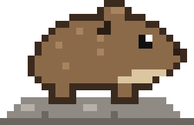

<p align="center">
  
</p>

# dassie-50m

*Named after the dassie (rock hyrax), the small, round, rock-sunbathing mammal of South Africa.*

A {{params}} parameter Llama-style language model trained from scratch on
[TinyStoriesV2 (GPT-4 subset)](https://huggingface.co/datasets/roneneldan/TinyStories).
It writes short, simple children's stories in English.

Built as a learning project. All code (model, tokenizer training, training loop, export) is at
**https://github.com/khkstudios/dassie-50m**.

## Quick start

```python
from transformers import AutoModelForCausalLM, AutoTokenizer

tok = AutoTokenizer.from_pretrained("{{repo}}")
model = AutoModelForCausalLM.from_pretrained("{{repo}}")

inputs = tok("Once upon a time", return_tensors="pt")
out = model.generate(**inputs, max_new_tokens=200, do_sample=True, temperature=0.8, top_p=0.95)
print(tok.decode(out[0], skip_special_tokens=True))
```

No `trust_remote_code` is needed. The weights are a standard `LlamaForCausalLM`, and
`generation_config.json` already sets the sampling defaults above.

### llama.cpp / Ollama / LM Studio

```bash
python llama.cpp/convert_hf_to_gguf.py ./dassie-50m --outfile dassie-50m-f16.gguf --outtype f16
./llama.cpp/build/bin/llama-cli -m dassie-50m-f16.gguf -p "Once upon a time" -n 200
```

## Model details

| | |
|---|---|
| Architecture | Decoder-only transformer (Llama: RMSNorm, RoPE, SwiGLU, pre-norm) |
| Parameters | {{params}} (tied input/output embeddings) |
| Layers / hidden / heads | 10 / 640 / 10 (head dim 64) |
| FFN hidden | 1728 |
| Context length | 512 tokens |
| Tokenizer | Byte-level BPE, 8,192 vocab, trained on TinyStoriesV2 |
| Special token | `<\|endoftext\|>` (id 0) serves as BOS, EOS and pad |

## Training

| | |
|---|---|
| Data | TinyStoriesV2-GPT4-train, ~530M tokens; 0.5% of stories held out for validation |
| Text cleaning | Curly quotes and dashes normalized to ASCII |
| Optimizer | AdamW (β 0.9/0.95, wd 0.1), peak LR 1e-3, warmup 500 steps, cosine decay to 1e-4 |
| Batch | 131,072 tokens/step (32 × 8 accum × 512) |
| Schedule | 8,000 steps (~1.05B tokens, ~2 epochs) |
| Best checkpoint | step {{best_step}} ({{tokens_seen}} tokens) |
| Hardware | Apple Mac Mini M4 (PyTorch MPS, bf16 autocast) |
| Validation loss | {{val_loss}} (perplexity {{val_ppl}}) |

The full loss curve is in [`training_log.csv`](training_log.csv).

## Samples

{{samples}}

## Limitations

- It only knows the narrow world of TinyStories: simple vocabulary, short stories for young children.
- It isn't instruction-tuned and doesn't answer questions; it continues text.
- It can produce repetitive or inconsistent stories, and any biases in the GPT-4-generated dataset carry over.
- It isn't suitable for any production or factual use.

## License & citation

The model weights and code are released under MIT. The training data is TinyStories by Ronen Eldan and Yuanzhi Li
([paper](https://arxiv.org/abs/2305.07759)), distributed under CDLA-Sharing-1.0.

```bibtex
@article{eldan2023tinystories,
  title   = {TinyStories: How Small Can Language Models Be and Still Speak Coherent English?},
  author  = {Eldan, Ronen and Li, Yuanzhi},
  journal = {arXiv preprint arXiv:2305.07759},
  year    = {2023}
}
```
